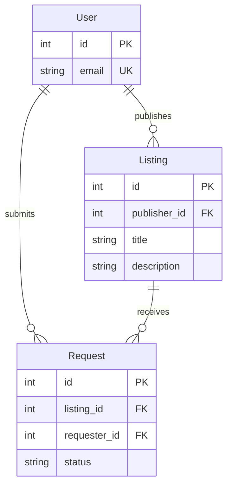

[← Documentation Home](README.md)

# Data Model

## Overview

[Briefly describe what data your app stores and how the data model supports the platform's core functionality. In particular, explain how the two user groups and their interactions are represented.]

## Entity-Relationship Diagram

[Visualize your app's data model using an Entity-Relationship Diagram (ERD). Include the main entities, their relevant attributes, primary and foreign keys, and relationship cardinalities (e.g., one-to-many or many-to-many).

You can use [Mermaid](https://mermaid.js.org/syntax/entityRelationshipDiagram.html) to create the diagram directly in Markdown, as illustrated by the following example. Replace this example with your own data model.]

## Entities and Relationships

[Briefly explain the purpose of the main entities and how they relate to each other. Focus on aspects that aren't immediately obvious from the diagram. In particular, explain how your data model represents the two user groups, the offered products or services, and the interactions between supply and demand.

Do not simply repeat attribute definitions or relationship cardinalities already visible in the ERD.

## Related Design Decisions

[Link to the Design Decisions that explain important choices in your data model, such as the representation of user roles, relationships between entities, or data integrity constraints. Keep the rationale in those documents rather than duplicating it here. Use relative links for referencing, like so:

- [01: How to access the database - SQL or SQLAlchemy](design-decisions/dd-01.md)

[**Important:** The documented data model, including related Design Decisions, must reflect your app's actual implementation.]