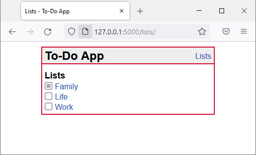

> [!IMPORTANT]
> Any text enclosed by `[ ]` are **placeholders**, including the opening and closing brackets.
>
> You may delete this `!IMPORTANT` box.

# [Project Name]

[Include a short project description. Below, include a representative, attractive screenshot of your final web app.]

---

## Documentation Contents

- [Value Proposition](01-value-proposition.md)
- [Data Model](02-data-model.md)
- [Design Decisions](design-decisions/README.md)
- [Product Discovery](product-discovery/README.md)
- [Contributors](contributors/README.md)

---

## Refinements since Submission

[List (a) which refinements or improvements you have promised during Oral Examination and (b) to which extent you managed to implement them with the Refined Submission (and reasons for deviations, if any).]